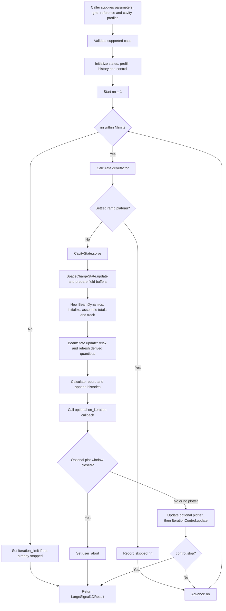

# Orchestration of the nonlinear 1D solver

This describes the current implementation in
[`src/solver/large_signal_1d.py`](../src/solver/large_signal_1d.py).
`solve()` coordinates the existing physics classes and decides when another
pass is needed. The individual classes implement the circuit, space-charge,
tracking, and beam-update calculations.

The central sequence is:

```text
Previous beam estimate
    -> solve cavity circuit
    -> calculate space charge and prepare tracking fields
    -> track the prescribed entrance beam again
    -> reconstruct new charge harmonics
    -> relax the beam estimate
    -> record diagnostics and decide whether to continue
```

Each `nn` is a nonlinear iteration, not a physical time step. Each evaluated
iteration tracks a fresh copy of the same entrance beam through the domain.
Within that pass, spatial and optional time stepping calculate its motion.

**Current field connection:** the circuit feels the beam through `C3 * Iz`,
but this entry point leaves `Emz = Emz0 = 0`, following the available MATLAB
source. `Vnc` is solved and monitored but is not converted into an accelerating
cavity field. Space charge supplies the force in the current tracking pass.
The diagrams below describe this implemented behavior.

## 1. Inputs and object lifetimes

The caller constructs these six objects before calling `solve()`:

| Input | What it supplies |
| --- | --- |
| `numerical` | Harmonic count, iteration budget, tolerances, relaxation and tracking controls |
| `beam` | Prescribed entrance current, voltage, arrival phases, active samples and beam geometry |
| `cavities` | Resonances, losses, input power, coupling and cavity positions |
| `grid` | Physical and normalized longitudinal coordinates and space-charge integration windows |
| `reference` | Reference current, voltage, velocity and relativistic quantities |
| `cavity_fields` | Interpolated spatial profiles `ez` and coupling coefficients `C3` |

`solve()` does not build the grid or import cavity maps. It reads these inputs
and creates independent working states for each call.

| Object | Created | What survives into the next evaluated iteration |
| --- | --- | --- |
| `BeamState` | Once per solve | Relaxed `Iz`, `QQ`, `IzDC`, `QQDC`; updated `effe`, `vez`, `gamaz` |
| `CavityState` | Once per solve | Excitation, latest `Mc`, `B`, `Vnp`, `Vnc`, and comparison voltage `flagVnc` |
| `SpaceChargeState` | Once per solve | Fixed `wp`, geometry and prefill arrays; selected `SCmethod`; latest fields |
| `BeamDynamics` | Fresh for every evaluated pass | No trajectory continuation into the next nonlinear pass; only the final object is returned |
| `ConvergenceHistory` | Once per solve | One immutable diagnostic record per evaluated pass |
| `IterationControl` | Once per solve | Comparison efficiency `effendflag`, stop flag, reason and success flag |

`SpaceChargeState.initialize()` computes the upstream prefill once. Its
tracking fields initially remain zero. `SCmethod` starts at `0` (local).
`flagVnc` and `effendflag` start at zero.

## 2. Overall control flow



A skipped ramp index executes no circuit solve, field update, tracking,
relaxation, diagnostic callback or control update. The last working state is
retained while the ramp schedule advances.

## 3. One evaluated iteration: calls and data flow

```mermaid
sequenceDiagram
    participant L as large_signal_1d.solve
    participant C as CavityState
    participant S as SpaceChargeState
    participant D as BeamDynamics
    participant B as BeamState
    participant H as Diagnostics and history
    participant U as IterationControl
    Note over L,U: One evaluated nn; BeamState initially holds the previous estimate
    L->>C: solve(..., beam_state, drivefactor)
    C->>C: assemble_Mc_B(), then numpy.linalg.solve()
    Note over C: Store Vnp and Vnc; leave flagVnc unchanged
    L->>S: update(nn, ..., beam_state, fillfactor, DCSPfactor)
    Note over S: Local or global fields; zero on nn = 1
    Note over L: Emz and Emz0 allocated once as zero cavity contributions
    L->>D: initialize(...) for a fresh entrance beam
    L->>D: track(..., Esz, Esz0, Emz, Emz0, old Iz)
    D->>D: Assemble Esmz and Esmz0 once from separate contributions
    D->>D: track_z()
    opt Spatial march requests time continuation
        D->>D: track_t() on the same trajectories and accumulators
    end
    D->>D: calculate_QQr() from current continuity
    D-->>L: Return total RF and DC fields for diagnostics
    L->>B: update(..., dynamics)
    Note over B: Relax sources, then replace effe, vez and gamaz
    L->>H: Calculate record; append record and voltage/drive histories
    L->>L: Optional callback, then plotter check/update
    L->>U: update(record, ..., drivefactor)
    Note over U: Stop, switch SC method, or retain comparison values
```

| Stage | Reads | Writes and physical meaning |
| --- | --- | --- |
| Circuit | Previous `beam_state.Iz`, `C3`, circuit parameters and drive | Rebuilds `Mc`, `B`; solves port and cavity-mode voltages |
| Space charge | Previous current/charge and effective velocity; fixed prefill | Produces RF phasors `Esz` and DC field `Esz0` for this pass |
| Tracking | Prescribed entrance samples and prepared fields | Produces new trajectories, crossing sums, energy flux and exit information |
| Continuity | New complex `Izr` | Produces new charge harmonics `QQr` after tracking |
| Relaxation | Previous beam estimate and new accumulators | Produces the beam estimate used by the next circuit and space-charge solves |
| Diagnostics | Current `Vnc`, relaxed beam diagnostics, tracking status and comparison values | Produces `effend`, voltage residual, efficiency residual and electron-status label |
| Control | Diagnostic record, SC mode, drive and numerical settings | Chooses stop/continue, next SC mode and next comparison values |

### Circuit system

For `Nc` cavities, the current implementation assembles one coupled system:

$$
M_c\,\mathbf v=B,\qquad
\mathbf v=(V_{np,1},V_{nc,1},\ldots,V_{np,N_c},V_{nc,N_c})^T.
$$

`Mc` has shape `(2*Nc, 2*Nc)`. `CavityState.solve()` calls
`assemble_Mc_B()` and `np.linalg.solve()`, then stores alternating solution
entries in `Vnp` and `Vnc`. The global matrix includes the configured cavity
couplings. It does not update the convergence reference `flagVnc`.

### Fields and tracking

`SpaceChargeState.update()` first clears its working fields, then selects:

| Condition | Field calculation |
| --- | --- |
| `nn == 1` or `wp == 0` | Leave tracking space-charge fields zero |
| `SCmethod == 0` | Local RF approximation using `Iz`, `vez`, `gamaz`; DC field is zero |
| `SCmethod == 1` | Integrate `QQDC`, `QQ` over the source windows and add the fixed upstream prefill |

In global mode, the assembly is:

```python
Esz = Esztotal[:, 1:] + fillfactor * Esz00[:, 1:]
Esz0 = DCSPfactor * (Esztotal[:, 0] + fillfactor * Esz00[:, 0])
```

The orchestrator passes only the separate RF and DC space-charge and cavity
contributions to `track()`. Tracking creates its own independent totals once:

```python
Esmz = Esz + Emz
Esmz0 = Esz0 + Emz0
```

The source arrays remain unchanged. `track_z()` and an optional `track_t()`
share the same totals, including all planes beyond a possible handoff.
`track()` returns `(Esmz, Esmz0)` for diagnostics; the orchestrator retains
these names in `LargeSignal1DResult`. `Esz0` names only the space-charge DC
contribution, available through `result.space_charge_state.Esz0`.

A nonpositive `iterfactor` enables the
existing rowwise SC correction after iteration 5, where the fundamental
current magnitude exceeds `0.01`; the default positive setting leaves it off.
The correction changes only affected rows to
`Esz[kz] * Izr[kz] / Iz[kz] + Emz[kz]`. It must happen during the spatial
march because `Izr[kz]` is the newly accumulated current. Uncorrected rows
already contain their ordinary sum and are not recomputed.

At each spatial push, the actual normalized electric field for electron `j` is

$$
E_{st,j}(z)=\operatorname{Re}E_{smz0}(z)
 +\operatorname{Im}\sum_{k=1}^{N_s}E_{smz,k}(z)
   e^{ikT_{nz}(z,j)}.
$$

Here `Esmz0` denotes the DC total assembled inside tracking. The field normalization
is `E[kV/mm] / (grid.betae * reference.U0)`. The explicit spatial Euler step
uses the **old plane and old arrival phase**. `track_z()` requests time
continuation when the inverse-velocity increase exceeds `evolutionmethod[0]`.
`track_t()` continues the same pass; it does not reset its trajectories.

After tracking, continuity gives

$$
QQ_{r,k}=-\frac{1}{ik}\frac{d I_{zr,k}}{dz}.
$$

The derivative uses the normalized spatial grid, even though its spacing is
stored as `grid.dt`. DC charge `QQDCr` is accumulated separately at crossings.

### Relaxation and the next beam estimate

Let `a = abs(numerical.iterfactor)`. For each beam source,

$$
X_{\mathrm{next}}=(1-a)X_{\mathrm{old}}+aX_r,
\qquad X\in\{I_{zDC}, I_z, QQ_{DC}, QQ\}.
$$

Complex phasors are mixed directly, preserving their phase. Then
`BeamState.update()` recomputes `effe`, `vez`, and `gamaz`, using this pass's
**unrelaxed `Pe`** and the **already relaxed `IzDC`**, in MATLAB's order.
These derived quantities are replaced directly rather than relaxed again.

The beam source estimate has now advanced to the next nonlinear iterate;
the circuit and fields still belong to the pass that just used the old estimate.

## 4. Convergence and branch decisions

Diagnostics are calculated before control changes any comparison values:

$$
\mathrm{residential}
=\max_c\frac{|\mathrm{flagVnc}_c-V_{nc,c}|}{|V_{nc,c}|},
\qquad
\mathrm{residentialel}
=\left|\frac{\mathrm{effendflag}-\mathrm{effend}}{\mathrm{effend}}\right|.
$$

`effend` is interpolated from `beam_state.effe` at
`max(grid.zi) - numerical.efficiency_end_offset_mm`.
Voltage differences are complex, so phase changes contribute to the residual.
No denominator floors are applied: zero denominators can produce `inf` or
`nan`; the voltage reduction omits individual NaNs as MATLAB does.
`residentialel` is diagnostic, not an additional convergence requirement.

The following decisions are evaluated in order. Write `r = residential`,
`R = Rlimit`, and `h = evolutionmethod[1]`.

| Priority | Condition | Action |
| --- | --- | --- |
| Before control | Optional plot window is closed | Stop with `user_abort` |
| 1 | Optimization mode and `Yflag != len(Y)` | Stop with `electron_loss` |
| 2 | Global SC, `r < R`, full drive | Stop with `converged`; `iterationsuc = 1` |
| 2 | Local SC, `h <= R`, `r < h`, full drive | Stop with `converged`; `iterationsuc = 1` |
| 3 | Local SC, `h > R`, `r < h` | Select global SC for the next pass; reset both comparison values to zero |
| Otherwise | No preceding branch applies | Copy `Vnc` to `flagVnc` and `effend` to `effendflag` |
| After reference/mode update | `nn >= Nlimit` | Stop with `iteration_limit` |

Full drive means `drivefactor == 1.0`. Switching to global SC may happen
before full drive. That switch retains the actual voltages and relaxed beam;
only the comparison values are reset. `IterationControl` owns these changes.
Consequently, `history.last` is not always the next comparison reference.
At the iteration limit, a requested SC switch may never receive another pass.

Outside optimization mode, the voltage convergence test does not require all
particles to exit downstream. `electron_status` remains a diagnostic label.
Exceptions from the calculations or callback propagate to the caller rather
than becoming a normal `LargeSignal1DResult` termination reason.

## 5. Optional input-power ramp

Without ramping, `drivefactor = 1`. With ramping,

$$
\mathrm{drivefactor}(nn)=
\sqrt{\min\left(
\frac{\lfloor 2\,nn\,N_{pin}/N_{limit}\rfloor+1}{N_{pin}},\,1
\right)}.
$$

It multiplies the input voltage amplitude; its square is the power fraction.
For `nn > 1`, a ramp plateau is skipped when the last voltage residual is
below `Rlimit` and the drive is unchanged from the preceding attempted index.
Final convergence still requires full drive. If skips exhaust the loop budget,
the orchestrator explicitly records `iteration_limit`.

## 6. Observing a pass and interpreting the result

`on_iteration(record, beam_state, cavity_state, space_charge_state, dynamics)`
runs after beam relaxation and history recording but **before** plotter and
control decisions. It sees the SC mode used for that pass. Treat the live
states as read-only and copy arrays to preserve snapshots. The callback is
not called for ramp-skipped indices. The solver itself creates no plots or
files; an explicitly supplied callback or plotter can do so.

`LargeSignal1DResult` returns:

| Result member | Meaning |
| --- | --- |
| `beam_state` | Final relaxed beam estimate and derived profiles |
| `cavity_state` | Last evaluated circuit solution, matrix and control reference |
| `space_charge_state` | Fixed prefill, last fields and control-selected SC mode |
| `dynamics` | Last evaluated pass's trajectories, raw sources and exit information |
| `history` | Diagnostic records from evaluated passes only |
| `control` | Stop reason, success flag and comparison efficiency |
| `nn` | Last attempted nonlinear index, including skipped ramp indices |
| `Vnc_history`, `Vnp_history` | Copied voltage arrays, one row per evaluated pass |
| `drivefactors`, `SCmethods` | Drive and SC mode actually used in those same passes |
| `skipped_iterations` | Attempted ramp indices at which no new solution was calculated |
| `Emz`, `Emz0` | Cavity RF/DC contributions from the last evaluated pass |
| `Esmz`, `Esmz0` | Total RF/DC fields used in the last evaluated tracking pass |

History rows align with `history.records`, not with every integer from `1`
through `nn`. `SCmethods[-1]` identifies the last pass's mode; the returned
`space_charge_state.SCmethod` can instead hold a mode selected for a next pass.
There is **no extra field or circuit solve after the final beam relaxation**.
Comparing final fields against final beam sources must account for this order.

## 7. Scope and entry points for further reading

The entry point supports cylindrical beams and standing-wave RF input,
bunching and output cavities with `mono=1`. It rejects sheet-beam, monotron,
DC-gap and traveling-wave cases. Final RF power/loss accounting, corrected
power-ramp efficiency tables and export/animation are separate work.

| Responsibility | Implementation |
| --- | --- |
| Orchestration and result | [`large_signal_1d.py`](../src/solver/large_signal_1d.py) |
| Circuit assembly and solution | [`cavity_state.py`](../src/solver/cavity_state.py) |
| Prefill and local/global space charge | [`space_charge.py`](../src/solver/space_charge.py) |
| Spatial/time tracking and charge reconstruction | [`beam_dynamics.py`](../src/solver/beam_dynamics.py) |
| Beam initialization and relaxation | [`beam_state.py`](../src/solver/beam_state.py) |
| Residuals, history and decisions | [`convergence.py`](../src/solver/convergence.py) |
| Paired Python/MATLAB nonlinear test | [Test 7 README](../test/7.nonlinear_iteration_test/README.md) |
| Orchestration checks | [`test_large_signal_1d.py`](../test/test_large_signal_1d.py) |

The Mermaid blocks provide an overall flowchart and a UML-style sequence
diagram. The tables and plain-text sequence remain readable without a Mermaid
renderer.
